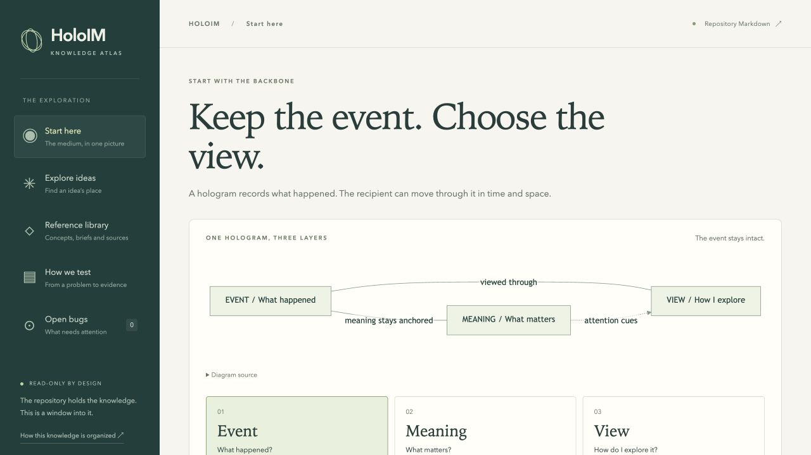

# Feature brief: Atlas visual narrative

**Lead:** Codex
**Status:** Complete (ported onto `main` 2026-11-11)

## User outcome

Understand the HoloIM backbone and where an idea belongs without reading a manual. Navigate from a visual model to a concrete example, related ideas, experiments, and source detail when needed.

## Scope

Included: concise Markdown-backed reading guide; Event/Meaning/View interactive flow; illustrative storyboard/wireframe with Follow/Free; grouped idea navigation and compact results; dependency/reasoning map; visual learning loop; concise wiki navigation; progressive disclosure in idea/document detail; responsive navigation and source freshness.
Excluded: changing HoloIM product decisions, implementing actual XR authoring/playback features, replacing canonical docs, knowledge editing/write-back or server-side persistence, external sharing.

## Acceptance criteria

- [x] Home explains Event/Meaning/View visually, with a single selectable layer and concise explanation; no full APPROACH.md dump.
- [x] One illustrative communication example connects a recorded event, meaning and recipient view; Follow/Free wireframe changes are labeled conceptual rather than shipped capabilities.
- [x] Ideas open as grouped territories rather than 69 expanded prose cards. All ideas remain searchable/discoverable; new IDs fall back to canonical text.
- [x] A relationship map explains specific canonical links (e.g. pointing enables attention/subtitles), without presenting speculative dependencies as approved work.
- [x] A separate visual process explains problem -> hypothesis -> smallest trial -> evidence -> decision, with details on demand and source links.
- [x] Wiki/PRDs/bugs/full Markdown stay accessible with statuses, source links, deep links, history, safety and live updates intact.
- [x] The guide and any concise editorial summaries live in Markdown and update through the existing watcher.
- [x] Keyboard, desktop and 390px mobile workflows have repeatable browser evidence.

## Design review

The current home displays a long approach document after a decorative hero. The garden requires scanning many similarly weighted cards. Wiki cards repeat document structure rather than explaining relationships. The existing warm paper/teal visual language is retained; the change is hierarchy, narrative and interaction. Source documents remain reference views, not default reading surfaces.

The new narrative is: understand the medium -> see one example -> find an idea's place -> follow a reasoning link -> choose a useful trial. Diagram connections describe conceptual relationships, not implementation sequencing. Parked notes and current portal/body-first priorities remain explicit.

## Failure cases considered

| Failure | Prevention / evidence |
| --- | --- |
| Concise copy diverges from canonical decisions | Editorial guide links authority; no statuses inferred from presentation |
| Source guide or summary missing | Canonical registry fallback; visible source links |
| New ideas disappear from curated map | Group dynamically by layer; all/search always includes every record |
| Diagram cannot be read on phones or by keyboard | Semantic buttons/links and stacked mobile flows; browser tests |
| Links or PRD decisions lost during redesign | Preserve hash routes and source reader; test parked PRD and history |
| Illustrative wireframe mistaken for a real product demo | Explicit conceptual example label and source explanation |
| Markdown updates overwrite user exploration or remain stale | Existing polling reload; URL stores selected route/collection/layer where useful |

## Ownership

Lead: app, source guide, feature brief and browser coverage. Independent design review: read-only reviewer if available. Verification: real browser workflows; preserve ongoing work in other worktrees and shared ports.

## Validation

Scoped lint/tsgo/build/Markdown integrity and browser E2E; verify:agent in the edit loop; verify:pr before integration. Screenshot/trace evidence under output/atlas-narrative. No physical XR claims.

## Verification Results

Original verification (2026-10-19, Node 22): scoped lint/tsgo/Markdown integrity,
11 Atlas browser tests, full `verify:pr`; an independent reviewer's findings were
fixed and rechecked. Emulation only; no physical-device claim.

Port onto current `main` (2026-11-11, Node 24, base `4b6d51bbb84d`):

- The branch had not merged since 2026-10-19. `main` had meanwhile changed the
  atlas (summaries precomputed in the Vite plugin so a live update does not
  reparse every document, the Design document kind and wiki grouping, the
  `KNOWLEDGE_E2E_PORT` runner, an open-bugs template check). Conflicts were
  resolved keeping `main`'s behaviour: the narrative's referenced-image scan now
  caches per document content like the summaries, so a live update still
  reparses only changed files.
- `idea-labels.md` dropped IDEA-047 and IDEA-057, which `main` had removed from
  the registry (the integrity check caught them).
- `pnpm --filter @holoim/knowledge run verify:fast` (docs integrity: 77 ideas,
  82 documents; ESLint with the CSS-literal check; tsgo) passes.
- `KNOWLEDGE_E2E_PORT=4276 pnpm --filter @holoim/knowledge run test:e2e`: 11 of
  11 pass, including main's open-bug template check and the live-update
  atomic-replace/rename test.
- `pnpm --filter @holoim/knowledge run verify:full` (docs integrity, lint, tsgo,
  production build including Mermaid, then the 11 browser tests) passes, and
  `pnpm run doctor` passes. This is the knowledge scope of `verify:pr`; the
  change touches no other package, so the capture and viewer suites do not apply.
- Proof video (ignored, `output/atlas-narrative-proof/atlas-narrative-proof.mp4`,
  recorded by `record.mjs` beside it): home backbone and layer selection,
  Follow/Free wireframe with the keyboard slider, grouped idea territories and
  search, the learning-loop page, the wiki, a live edit of `ATLAS_GUIDE.md`
  changing the headline, a new Markdown file appearing in the wiki, and 390px.

## Visual Evidence

Production-preview snapshot, 2026-10-19. This is evidence of the knowledge reader,
not a claim that the illustrative hologram interactions are shipped product features.
Desktop/mobile workflow screenshots and browser reports are generated by
`apps/knowledge/e2e/atlas.spec.ts` under `output/atlas-narrative/` when collected.

## Integration

Merged to `main` 2026-11-11 after the incoming capture and hand-tracking work
the original note waited for had long landed. The old `feature/atlas-narrative`
branch and worktree were removed.
