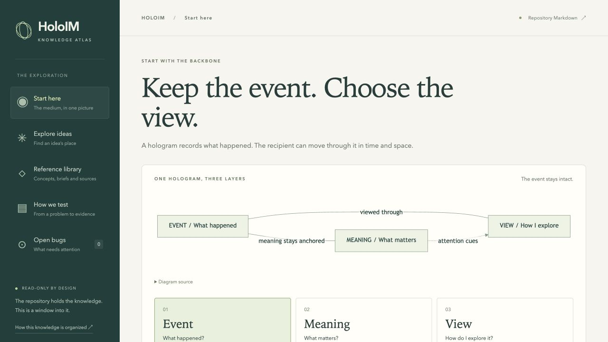

# Feature brief: Atlas visual narrative

**Lead:** Codex
**Status:** Verified (awaiting integration)

## User outcome

Understand the HoloIM backbone and where an idea belongs without reading a manual. Navigate from a visual model to a concrete example, related ideas, experiments, and source detail when needed.

## Scope

Included: concise Markdown-backed reading guide; Event/Meaning/View interactive flow; illustrative storyboard/wireframe with Follow/Free; grouped idea navigation and compact results; dependency/reasoning map; visual learning loop; concise wiki navigation; progressive disclosure in idea/document detail; responsive navigation and source freshness.
Excluded: changing HoloIM product decisions, implementing actual XR authoring/playback features, replacing canonical docs, knowledge editing/write-back or server-side persistence, external sharing.

## Acceptance criteria

- [x] Home explains Event/Meaning/View visually, with a single selectable layer and concise explanation; no full APPROACH.md dump.
- [x] One illustrative communication example connects a recorded event, meaning and recipient view; Follow/Free wireframe changes are labeled conceptual rather than shipped capabilities.
- [x] Ideas open as grouped territories rather than 69 expanded prose cards. All ideas remain searchable/discoverable; new IDs fall back to canonical text.
- [x] A relationship map explains specific canonical links (e.g. pointing enables attention/subtitles), without presenting speculative dependencies as approved work.
- [x] A separate visual process explains problem -> hypothesis -> smallest trial -> evidence -> decision, with details on demand and source links.
- [x] Wiki/PRDs/bugs/full Markdown stay accessible with statuses, source links, deep links, history, safety and live updates intact.
- [x] The guide and any concise editorial summaries live in Markdown and update through the existing watcher.
- [x] Keyboard, desktop and 390px mobile workflows have repeatable browser evidence.

## Design review

The current home displays a long approach document after a decorative hero. The garden requires scanning many similarly weighted cards. Wiki cards repeat document structure rather than explaining relationships. The existing warm paper/teal visual language is retained; the change is hierarchy, narrative and interaction. Source documents remain reference views, not default reading surfaces.

The new narrative is: understand the medium -> see one example -> find an idea's place -> follow a reasoning link -> choose a useful trial. Diagram connections describe conceptual relationships, not implementation sequencing. Parked notes and current portal/body-first priorities remain explicit.

## Failure cases considered

| Failure | Prevention / evidence |
| --- | --- |
| Concise copy diverges from canonical decisions | Editorial guide links authority; no statuses inferred from presentation |
| Source guide or summary missing | Canonical registry fallback; visible source links |
| New ideas disappear from curated map | Group dynamically by layer; all/search always includes every record |
| Diagram cannot be read on phones or by keyboard | Semantic buttons/links and stacked mobile flows; browser tests |
| Links or PRD decisions lost during redesign | Preserve hash routes and source reader; test parked PRD and history |
| Illustrative wireframe mistaken for a real product demo | Explicit conceptual example label and source explanation |
| Markdown updates overwrite user exploration or remain stale | Existing polling reload; URL stores selected route/collection/layer where useful |

## Ownership

Lead: app, source guide, feature brief and browser coverage. Independent design review: read-only reviewer if available. Verification: real browser workflows; preserve ongoing work in other worktrees and shared ports.

## Validation

Scoped lint/tsgo/build/Markdown integrity and browser E2E; verify:agent in the edit loop; verify:pr before integration. Screenshot/trace evidence under output/atlas-narrative. No physical XR claims.

## Verification Results

- Scoped Markdown integrity, shared ESLint and tsgo pass.
- Browser E2E: 11 passed, including new IDs, parked PRD/history, all-doc freshness/renames, unsafe Markdown, sourced Mermaid/wireframe copy, local-image deletion, reading-state preservation and missing-guide exits.
- Independent reviewer found and rechecked fixes for competing wireframe copy, inferred/event boundary, missing-guide fallback and refresh state. Relationship selection is now also persisted.
- Rebased onto `de26df9eb70c` before full verification; preserved the approved portal PRD and all unrelated changes.
- `pnpm run verify:agent` passed (comprehensive workspace checks).
- `pnpm run verify:pr` passed on Node 22: lint, types, existing tests, builds, 11 Atlas browser tests, 3 capture/viewer pipeline tests, 6 capture XR flows and 9 viewer browser/XR checks. Ports were isolated: API 3301, viewer 3474, capture 5574/5575, Atlas tests 4276.
- A production preview also rendered the Markdown diagrams successfully.
- XR results establish browser emulation, not physical-headset behavior. This feature makes no physical-device claim.
- Integration remains pending the incoming capture/hand-tracking merge in the main checkout.

## Visual Evidence

Production-preview snapshot, 2026-10-19. This is evidence of the knowledge reader,
not a claim that the illustrative hologram interactions are shipped product features.
Desktop/mobile workflow screenshots and browser reports are generated by
`apps/knowledge/e2e/atlas.spec.ts` under `output/atlas-narrative/` when collected.

## Integration Boundary

The main checkout contains incoming Quest hand-tracking/recording changes. The
user confirmed those are being merged, not abandoned work. Preserve them. This
feature changes only the knowledge app, its Markdown reading layer, owned feature
record and dependency lock. Integrate after the incoming checkout is safe to update;
do not stash or discard someone else's edits to force an integration.
