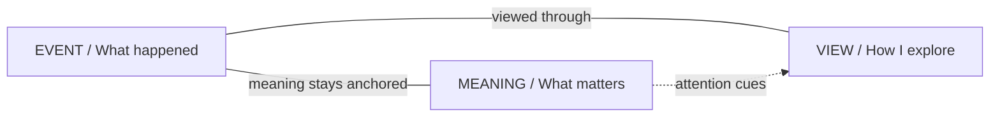
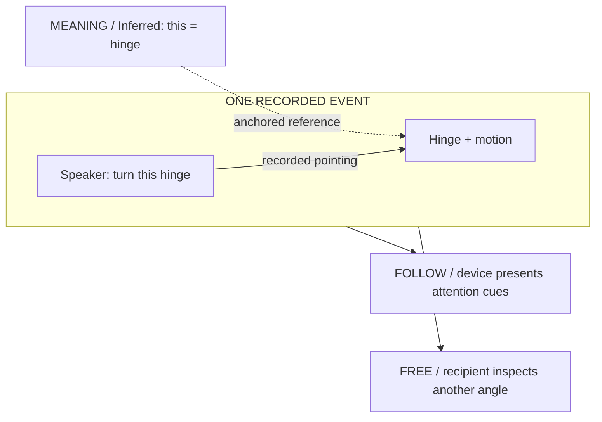
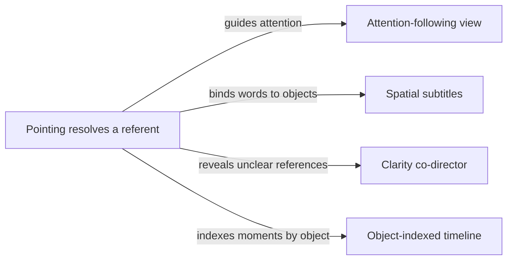
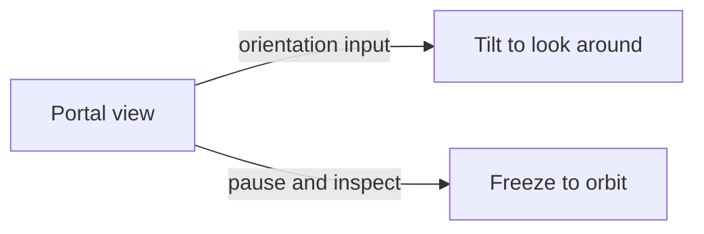
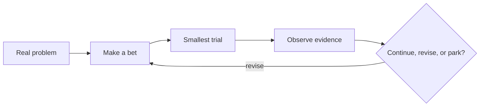

# Atlas Reading Guide

This is the concise reading layer for the Knowledge Atlas. It organizes the
existing knowledge; it does not approve features or replace their source docs.
The [agreed hologram model](concepts/what-a-hologram-is.md) owns the philosophy,
[IDEAS.md](IDEAS.md) owns ideas, and each PRD owns its decision.

## Opening

| Key | Copy |
| --- | --- |
| Title | Keep the event. Choose the view. |
| Intro | A hologram records what happened. The recipient can move through it in time and space. |
| Example title | “Turn this hinge, like this.” |
| Example intro | One explanation, three layers. Select a step to see what each layer contributes. |
| Map title | Find an idea's place. |
| Map intro | Start with the part of communication you want to improve. |
| Process title | Build understanding, one trial at a time. |
| Process intro | Start with a real communication problem. Learn whether the medium helps before expanding it. |

## Backbone Map

These are three layers of the same event, not a destructive conversion pipeline.
Meaning remains anchored to the event; each viewer opens a view of that event.

## Layers

| Key | Number | Title | Question | Summary | Detail | Example | Source |
| --- | --- | --- | --- | --- | --- | --- | --- |
| Event | 01 | Event | What happened? | Body, voice, objects, place and time. | Capture the performance faithfully at true scale. Keep recorded motion distinguishable from synthesized motion. | A person points at a hinge and rotates it. | docs/product/concepts/what-a-hologram-is.md |
| Meaning | 02 | Meaning | What matters? | References, emphasis, notes and symbols. | Read pointing and attention from the body first. People add what the performance could not say; provenance distinguishes recorded, inferred and added. | “This” is linked to the hinge being pointed at. | docs/product/concepts/communication-protocols.md |
| View | 03 | View | How do I explore it? | Viewpoint, scale, placement and playback. | The author directs attention. The recipient and device choose how to show it, in Follow or Free. | Pause, look behind the hinge, then follow again. | docs/product/concepts/viewer-experience.md |

## Example

This is an illustrative wireframe of a possible communication experience,
not a running hologram or evidence that these features have shipped.

| Layer | Label | Action | Result |
| --- | --- | --- | --- |
| Event | Record the explanation | The speaker points and turns a hinge. | Preserve the person, object, motion and voice together. |
| Meaning | Resolve “this” | Connect the pointing gesture to the hinge. | The recipient knows which part the speaker means. |
| View | Inspect the explanation | Follow the reference or explore the paused moment. | A new viewpoint can reveal what a fixed camera hid. |

## Wireframe

The app uses these labels in the conceptual sketch below. Change them here,
not in application code, when revising this example. Keep the diagram aligned.

| Key | Copy |
| --- | --- |
| Speaker | Speaker |
| Object | Hinge |
| Speech | “Turn this hinge, like this.” |
| Recorded reference | points at |
| Inferred reference | “this” refers to |
| Inference label | INFERRED REFERENCE |
| Event label | SAME RECORDED EVENT |
| Sketch label | EXPLANATION SKETCH |
| Disclaimer | Conceptual wireframe · not a running product demo |

## Example Wireframe

An illustrative layout, not implemented product behavior. The event persists
while the recipient changes viewpoint. Recorded, inferred and added content
must remain distinguishable.

## View Modes

| Mode | Label | Explanation |
| --- | --- | --- |
| Follow | Follow the explanation | The device presents the author's attention cues. |
| Free | Explore the moment | The recipient chooses a viewpoint without changing the recorded event. |

## Territories

| Layer | Title | Description |
| --- | --- | --- |
| Event | Capture the event | Preserve people, objects, motion and true scale. |
| Meaning (read) | Reveal what the body says | Resolve gestures, attention and implicit references. |
| Meaning (added) | Add what is missing | Put notes, symbols and other media into the event. |
| View | Let the recipient explore | Navigate time, viewpoint, scale and attention. |
| Conversation | Keep the exchange going | Reply, compare understanding and return to context. |
| All layers | Support the medium | Shared language, delivery, trust and operations. |

## Connections

These are product reasoning links from the agreed model, not a delivery
schedule or proof of technical prerequisites. Their endpoints remain ideas.

| From | To | Relationship |
| --- | --- | --- |
| IDEA-032 | IDEA-041 | A resolved referent can guide attention. |
| IDEA-032 | IDEA-014 | Words can point to the thing being discussed. |
| IDEA-032 | IDEA-023 | Unresolved references become clarity questions. |
| IDEA-032 | IDEA-044 | A referent can index its moments in the recording. |
| IDEA-045 | IDEA-042 | Phone orientation becomes a way to look around. |
| IDEA-045 | IDEA-043 | Pausing opens up space for inspection. |

## Pointing Map

Canonical reasoning links in the agreed model. Arrows explain a relationship,
not approval or a technical delivery order.

## Portal Map

## Learning Loop

A process template, not a record of completed experiments. A failed technical
workflow or missing recipient can make the observation inconclusive.

## Process

| Step | Title | Prompt | Detail | Source |
| --- | --- | --- | --- | --- |
| 01 | Find the breakdown | Who failed to understand what? | Pick a real speaker, recipient and repeated task. Name today's alternative: video, text, a diagram or a call. | docs/product/APPROACH.md |
| 02 | Make a bet | Why would space or presence help? | Combine a communication act with a medium property. Keep many ideas, but choose one observable outcome to explore. | docs/product/APPROACH.md |
| 03 | Try the smallest version | What can we learn without a platform? | Reuse capture → export → upload → view. Simulate missing pieces when that can answer the question. | docs/product/APPROACH.md |
| 04 | Observe the recipient | Can they do the task better? | Compare fairly with a decent alternative. Observe mistakes, clarification, author effort and voluntary repeat use. Technical success alone is not communication success. | docs/product/APPROACH.md |
| 05 | Decide what follows | Continue, revise, or park? | Record evidence and limits with the PRD. A broken workflow or unavailable recipient makes a trial inconclusive, not proof that the idea failed. | docs/product/prds/PRD-TEMPLATE.md |

## Agent Roles

| Role | Job | Output |
| --- | --- | --- |
| Human | Bring the real communication problem. | Product judgment and recipient observations. |
| Lead | Bound the outcome and integrate the work. | One brief with scope and acceptance criteria. |
| Reviewer | Challenge the approach before building. | Failure cases and specific changes to the brief. |
| Builder | Implement the assigned behavior. | A small complete workflow. |
| Verifier | Test the original brief independently. | Reproducible evidence and remaining limits. |

## How To Read And Maintain This Guide

- Humans: follow the model, one example, the idea territories, then the learning loop. Open reference documents only for the detail you need.
- Agents: preserve the named sections and table column names used by the reader. Mermaid fences are the diagram sources; tables supply concise copy, IDs and source links.
- Keep diagrams and their accompanying tables consistent when changing a relationship. Labels are in [idea-labels.md](research/idea-labels.md); canonical states stay in the registry, agreed model, PRDs and owning delivery files.
- Prefer text diagrams with short labels. If a future diagram needs an image, keep it beside the Markdown, embed it with a relative path, and include alt text plus a textual explanation for agents.
- The website is a read-only rendering of these sources. Editing a diagram or table in Markdown refreshes the running reader.
